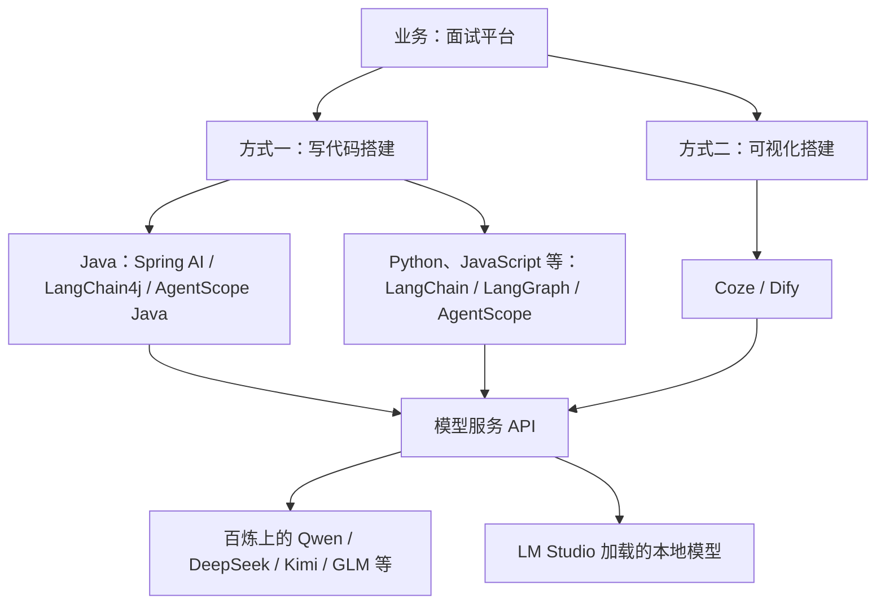
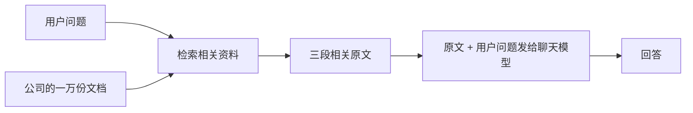
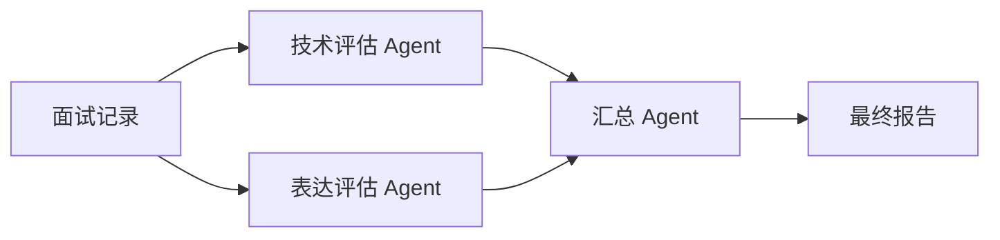
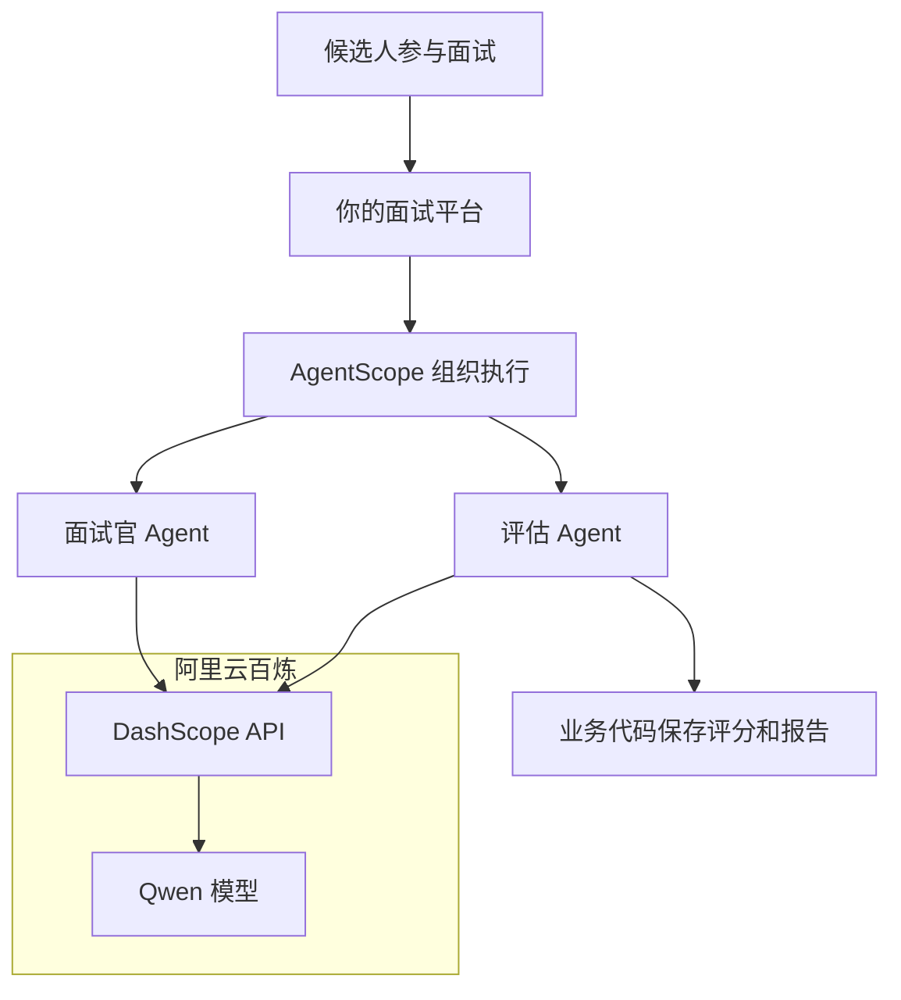

# 从调用模型到多 Agent：AI 应用开发概念地图

整理日期：2026-11-06。用途：个人学习笔记，结合面试平台理解概念，不作为具体版本的功能清单。

## 1. 先问：这些东西分别解决哪一层问题？

最容易困惑的原因：把模型、服务接口、开发框架、可视化平台放在一起比较。

| 层次 | 例子 | 回答的问题 |
| --- | --- | --- |
| 模型 | Qwen、DeepSeek 模型、Kimi、GLM | 谁理解输入、生成结果？ |
| 云服务平台 | 阿里云百炼、各厂商开放平台 | 在哪里开通模型服务、管理 Key 和用量？ |
| 调用接口与 SDK | DashScope API / SDK | 程序怎样调用云端能力？ |
| 代码框架 | Spring AI、LangChain4j、LangChain、LangGraph、AgentScope | 怎样在代码里接模型、工具，组织执行过程？ |
| 可视化应用平台 | Coze、Dify | 怎样通过界面配置 Agent、连接工作流、发布应用？ |
| 本地模型运行软件 | LM Studio | 怎样在自己的机器上加载模型并提供 API？ |

这些是按主要用途划分，实际产品的功能会重叠。它们不是必须全部安装的一条技术链。



图示为可选路线，不表示所有框架都支持全部语言，也不表示这些框架必须一起使用。

## 2. 流式输出和结构化输出为什么不冲突？

**疑问：模型不是逐步吐 Token 吗，怎么还有结构化输出？**

流式说的是传输过程；结构化说的是最终数据的形状。

模型可以逐步输出，最后组成：

```json
{"score":85,"suggestion":"补充线程池拒绝策略的适用场景"}
```

中间收到的内容可能只是半个 JSON。最简单的处理方式是累计接收，结束后再解析完整数据。更复杂的应用也可采用增量解析。

**疑问：前端又不展示 JSON，结构化有什么意义？**

普通聊天只需要把文字给人看，通常不需要额外的业务字段结构。面试报告却需要程序读取 `score` 画评分圆环、读取 `suggestion` 放入建议卡片，还要存数据库。

> 人要读一段话；程序要准确地拿到字段。结构化输出主要解决后者。

因此，文章从 Prompt 讲到结构化输出时，其实是在从“向模型说清要求”切换到“程序怎样可靠处理结果”。JSON 格式正确，也不等于评分事实正确，业务仍需校验。

## 3. 模型 API 自带分词，为什么还讲 Embedding？

**疑问：直接调用 DeepSeek 就能理解我，为什么要自己向量化？**

模型服务会在内部完成它需要的文本处理。你不用先建向量数据库，才能让它理解文本。

应用里额外调用 Embedding 模型，常见用途是从大量资料里找到语义相关的内容。



Embedding 参与的是检索环节。找到资料后，聊天模型接收到的可以仍是普通原文。

如果只有两页资料，直接连同问题发给模型即可，不一定需要 Embedding、向量数据库或检索系统。

**疑问：Embedding 模型的分词和聊天模型不一样，会出问题吗？**

不会仅仅因为两者分词不同就冲突：检索后交给聊天模型的是原文，它会自行处理。

真正要保证兼容的是文档向量和查询向量：它们通常应使用同一 Embedding 模型及兼容配置生成。仅维度相同，并不表示语义空间相同。

模型内部也有嵌入表示，但“内部计算”与“应用额外调用 Embedding 服务做检索”是两个层次。

## 4. RAG 不就是 ES 搜索吗？

RAG 的核心流程是“检索相关资料，再交给模型生成回答”。它不要求必须使用向量数据库。

| 检索方式 | 擅长的例子 |
| --- | --- |
| 关键词检索 | 型号、错误码、专有名词、精确词语 |
| 向量检索 | 用户说“晚上躺着很久睡不着”，找到讨论“失眠”的资料 |
| 混合检索 | 同时利用字面匹配与语义匹配 |

ES 是搜索系统，向量化是技术手段，两者不是二选一。Elasticsearch 本身也支持向量检索。自然语言提问容易和资料用词不同，所以 AI 教程经常强调向量检索，但它不是唯一方案。

## 5. 一个 Agent 已经能干活，为什么要多 Agent？

一个 Agent 可以分步骤调用工具、完成复杂任务。多个步骤不等于多个 Agent。

多 Agent 常见收益是并行、隔离上下文和职责、独立复核；代价是额外调用成本、交接信息损耗和排错难度。多个 Agent 也可能一起犯错。



这只是可选设计。先用一个 Agent 跑通，出现明确分工收益时再拆。

**疑问：Claude Code 创建子 Agent，不就是我说一句话吗？**

那句话是在调用 Claude Code 已经实现的能力。自行开发的应用也要预先具备创建独立会话、分配任务与工具、启动执行、接收结果等运行机制，模型说“我创建了助手”不等于程序真的创建了。

> 使用者只需要说一句话，开发者需要先实现这句话背后的功能。

**疑问：调度多个机器人，是不是多 Agent？**

不一定。一个 AI 调用清洁机、巡检机、配送机的接口，仍可以是单 Agent 调度多个执行设备。多 Agent 则是多个拥有模型驱动判断过程的执行单元协作。

## 6. 多 Agent 编排具体在编什么？

- 谁做：选择哪个 Agent，分配什么职责、资料和工具。
- 怎么接：把前一个结果作为后一个输入，定义共享状态。
- 怎么走：串行、并行、条件分支、循环、结束条件。
- 出问题怎么办：超时、重试、取消、人工介入和结果冲突处理。

编排也适用于普通工作流，不必每个节点都是 Agent。

## 7. 阿里的四个名字是什么关系？

| 名字 | 主要角色 |
| --- | --- |
| 百炼 | 云服务平台 |
| DashScope | 模型调用 API / SDK 名称 |
| Qwen | 实际处理输入、生成输出的模型系列 |
| AgentScope | 构建和运行 Agent、组织协作的框架 |



AgentScope 可以接其他厂商模型，不强制使用 DashScope 或 Qwen。业务规则、数据库访问工具、前端和权限仍由应用开发者负责。

## 8. Spring AI、LangChain4j、LangChain、LangGraph、AgentScope、Coze、Dify 怎么选位置？

| 工具 | 主要理解方式 | 面试业务中的例子 |
| --- | --- | --- |
| Spring AI | Spring 生态的 AI 接入与应用开发能力 | Java Service 调模型生成题目、映射评分对象 |
| LangChain4j | Java AI 框架，提供底层 API 和 AI Services 等高层抽象 | 定义评分接口，配置提示词、工具和结果映射 |
| LangChain | Python、JavaScript 的模型、工具和 Agent 开发框架 | 用代码搭建能调用业务工具的面试助手 |
| LangGraph | 有状态的流程编排框架与运行时 | 出题→等待回答→判断追问→继续或结束；支持暂停和恢复等需求 |
| AgentScope | Agent 构建、运行与协作框架，有 Python、Java 项目 | 面试官和评估 Agent 交接任务 |
| Coze | 可视化 AI 应用与 Agent 开发平台 | 界面配置面试助手、工具和工作流 |
| Dify | 可视化 AI 应用与工作流平台 | 拖节点连接简历提取、模型评分、HTTP 保存结果 |

这些框架功能会重叠，上表表示理解重点，不是独占功能或严格能力边界。

LangChain4j 是独立 Java 项目，不是 Python LangChain 的直接移植。LangChain 和 LangGraph 属于同一生态，当前 LangChain 的高层 Agent 建立在 LangGraph 之上；LangGraph 也可独立使用，不要求多个 Agent。

Coze、Dify 搭好的能力可通过 API 接入自有业务系统，但具体可用能力随产品版本和部署方式变化。

对当前面试平台，已经选择的是“Java 写业务 + Spring AI 接入模型”。不必为了凑齐名词引入全部工具。用户、会话、数据库、权限和页面仍是业务系统需要解决的事。

## 9. 以后遇到新名词，先问这四句

1. 它是模型、服务、框架，还是应用平台？
2. 不用它，原来的业务流程卡在哪一步？
3. 它是必需能力，还是某一种实现方案？
4. 用最小业务例子说明，它到底接收什么、输出什么？

避免把“可以这样搭建”误读为“必须这样搭建”。

## 官方资料

- [Spring AI](https://docs.spring.io/spring-ai/reference/)
- [LangChain4j](https://docs.langchain4j.dev/intro/)
- [LangChain 开源生态](https://www.langchain.com/oss-overview)
- [LangGraph](https://github.com/langchain-ai/langgraph)
- [AgentScope](https://github.com/agentscope-ai/agentscope)
- [AgentScope Java](https://github.com/agentscope-ai/agentscope-java)
- [Coze 工作流](https://www.coze.com/open/docs/guides/workflow)
- [Dify 工作流](https://www.dify.ai/workflows)
- [百炼 SDK：DashScope 与 OpenAI 兼容调用](https://help.aliyun.com/zh/model-studio/install-sdk)
- [LM Studio 本地 API 服务](https://lmstudio.ai/docs/developer/core/server)
- [Kimi API](https://platform.kimi.ai/docs/get-your-api-key)
- [DeepSeek API](https://api-docs.deepseek.com/)
- [智谱模型概览](https://docs.bigmodel.cn/cn/guide/start/model-overview)

来源说明：整理自本次学习对话及对话中查阅的官方资料；此笔记不宣称框架的某项能力只属于它，也不保证其他平台能原样渲染 Mermaid。框架具体配置、兼容版本和价格应以使用时的官方文档为准。
